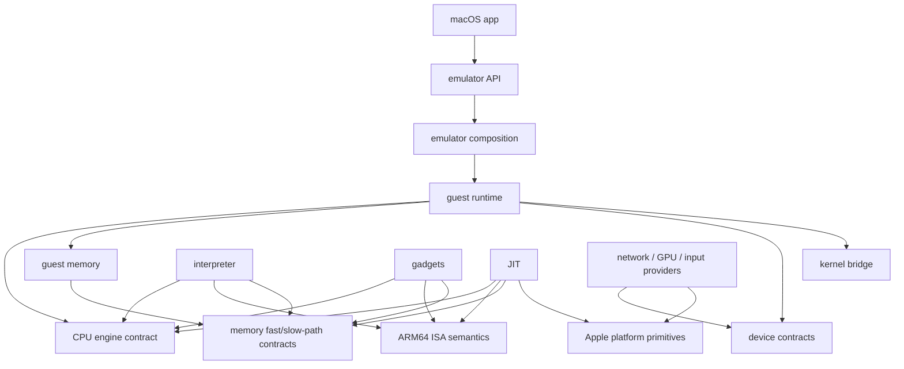

# Emulator Refactoring Plan

> Historical planning snapshot. It describes the pre-refactor audit and may
> intentionally use retired paths and counts. Read
> [`REFACTOR_PROGRESS.md`](REFACTOR_PROGRESS.md) for current implementation
> status and [`REFACTOR_HANDOFF.md`](REFACTOR_HANDOFF.md) for acceptance-gate
> status.

- Status: proposed; planning snapshot audited 2026-08-01
- Scope: organization and maintainability without changing guest-visible
  behavior or reducing performance
- Outer-tree baseline reviewed: `618b68658013b83394efef367570fa2c36113eb0`
- Linux HEAD reviewed: `588539de55b9480d78ffe6f07f6eb9171156e946`
- Linux delta reviewed: `3f2bdd681f495c24d34d353eea2b9588c4fd191f`
  through the Linux HEAD above

This document is a historical design snapshot, not the current handoff. A new
chat must start with [`REFACTOR_HANDOFF.md`](REFACTOR_HANDOFF.md), then read
[`kernel/README.md`](kernel/README.md) for the implemented Linux source model
and [`docs/testing.md`](docs/testing.md) for current commands. Use the phased
material below as design rationale only where the handoff has not superseded
it.

## Current scope amendments (2026-08-03)

These user-directed decisions supersede conflicting requirements in the
historical plan below:

1. A valid instruction that an engine has not implemented is a guest-scoped
   failure, not a fatal emulator event. It must terminate or signal the guest
   program through the normal guest illegal-instruction path without bringing
   down the emulator or silently switching engines. All three engines must
   agree on the guest-visible event and zero-retirement/PC semantics. A test
   must execute a known-good guest operation afterward to prove the emulator
   remains usable.
2. LibVNCServer must be built from the pinned official release archive exactly
   as upstream published it. Do not carry project patches or selected
   post-release backports merely for general upstream corrections. The current
   implementation task is to return the 0.9.15 manifest entry to version
   `0.9.15`, remove its patch metadata/files, derive the pristine prepared-tree
   identity, rebuild the private prefix, and rerun VNC/package consumers.
3. Rootfs image ownership, immutability hashes, sidecar locking, maintenance
   serialization, and related cleanup are deferred because the test-image
   model will be redesigned. They are not refactor acceptance gates. Existing
   protections may remain, but do not expand or refactor them now. Continue to
   avoid incidental destructive image changes unless a later task explicitly
   authorizes the new testing workflow.
4. Source-size guidance is advisory rather than a strict 1,000-line policy.
   Split mixed responsibilities into logical owners, but permit cohesive,
   order-sensitive, generated-like, or hot-path units to remain longer when the
   ownership is clear and the split would obscure or perturb the code.
5. Interpreter, gadget, native-shadow, and software-MMU paths must remain
   data-only on sandboxed iOS: no W+X mapping and no RW/RX transition. Dynamic
   executable publication may remain only in the explicitly selected JIT path
   for entitled debugger or jailbreak use; it must not leak into non-JIT paths.
6. Interpreter acceptance is deliberately lightweight. Do not run Node.js,
   Go, browsers, benchmarks, or similarly heavy real workloads through the
   interpreter; those workloads are too slow there and are not refactor gates.
7. Reproducible external inputs mean authenticated source archives, patch bytes
   and order, prepared source trees, build policy, and ABI identities. Kernel
   and external-library timestamps, build identities, user/host fields,
   compiler notes, package layouts, and binary hashes remain authentic dynamic
   metadata and need not be byte-for-byte deterministic.

## Goals

1. Give every module one responsibility and enforce an acyclic dependency
   graph.
2. Remove the `backend`/`frontend` split and use neutral emulator, runtime,
   platform, CPU, memory, and device terminology.
3. Put the interpreter, gadget, and JIT engines behind one production
   interface while retaining engine-specific hot loops.
4. Split implementation and build files by responsibility when that improves
   ownership and navigation. Do not include implementation fragments into C++
   source files or split cohesive hot/order-sensitive units merely by line
   count.
5. Put host virtual hardware below `darwin/device`, with one subtree and build
   target per device.
6. Make host-only unit tests independent of Python, the kernel, the emulator
   executable, and every rootfs image. Put all guest-boot/rootfs workflows in
   a separately configured integration suite.
7. Reduce the maintained Linux delta and keep the unavoidable delta as a small,
   reviewable patch series over a pristine upstream tree.
8. Remove empty directories, abandoned experiments, unreachable code, and
   unowned test assets only after coverage proves they are unused.

## Non-negotiable invariants

- Refactoring changes must not change architectural results, exception/fault
  priority, retired instruction counts, memory ordering, feature exposure, or
  engine selection defaults.
- The interpreter remains the strict, defensive reference implementation.
  Gadget and JIT production paths must not inherit interpreter-only checks.
- JIT remains an explicit engine with no fallback to gadgets. Unsupported
  instructions use the same guest-scoped illegal-instruction failure as the
  interpreter and gadgets; they must not become fatal emulator events.
- Host and implementation capability checks continue to constrain guest HWCAP
  and HWCAP2. The three engines must implement every feature advertised for
  their selected virtual CPU profile.
- The virtual interface is crossed once per guest entry/timeslice, not once per
  instruction or translated block. Engine inner loops, TLB fast paths, and
  translated code remain concrete and inlinable.
- Translation-time specialization, data-only gadget programs, block linking,
  cache topology, register layouts, and assembly-visible offsets must not be
  changed as a side effect of moving code.
- The default guest page size remains 16 KiB. The 4 KiB compatibility build
  remains buildable and tested.
- Rootfs file-management policy is deferred to the planned testing redesign.
  Existing overlay/verification behavior may remain, but changing locking,
  hashes, maintenance, or image ownership is outside the current refactor.
- Pure moves, naming changes, behavior changes, and performance changes belong
  in separate reviewable change sets. During the current refactor, do not stage
  or commit any of them without separate authorization.

## Audit baseline

The present shape makes the requested boundaries difficult to enforce:

| Area | Current evidence | Refactoring consequence |
|---|---:|---|
| Gadget translation | `program.cpp`: 14,160 lines | Split by responsibility and instruction family |
| JIT | `jit_executor.cpp`: 11,083 lines | Separate cache, linking, translation, emitters, helpers, and diagnostics |
| Build system | `darwin/backend/CMakeLists.txt`: 3,808 lines | Move targets/tests into their owning directories |
| Interpreter memory instructions | `load_store.cpp`: 2,795 lines | Split by architectural encoding family |
| Software MMU | `address_space.cpp`: 1,406 lines | Separate mappings, execution contexts, tags, and invalidation |
| Engine entry | Three loops in `static_guest.cpp` | Replace with one runtime adapter plus three implementations |
| Tests | 563 CTest cases; 555 native, 7 Python, 1 CMake audit | Separate and label suites; remove Python from unit path |
| Test metadata | 561 of 563 cases have no labels | Apply suite and domain labels centrally |
| Linux delta | 159 files, +9,331/-243 across 15 commits | Extract build/config/device work and split the remaining series |
| Empty source structure | `darwin/runtime/guest/{diagnostics,exception}` | Remove immediately when implementation starts |

Known layering violations include:

- JIT headers use gadget-owned `Event`, `Access`, `Program`, and `Tlb` types.
- JIT assembly includes gadget offset definitions.
- CPU semantics and gadget translation include runtime-owned host feature and
  static-MMU interfaces, while runtime includes the CPU implementations.
- `CpuState` mixes architectural state with fields named for gadget/JIT
  implementation scratch.
- Engine selection, task-frame import/export, signal-return handling, fault
  conversion, dispatch budgets, and profiling are duplicated across engine
  entry functions.
- Production and test-only JIT diagnostics are compiled from the same giant
  implementation file.
- Test helpers import one another across GPU, LTP, SMP, and performance
  directories instead of depending on one integration-support layer.
- `Backend::stop_requested_` is written but is not read. The cancellation
  contract must either be connected to execution or removed with its API.

## Build and test system decision

### Decision: modernize CMake/CTest; do not migrate during this refactor

Keep **CMake 3.27+ with Ninja** as the canonical first-party build and CTest as
the canonical test registry. Keep **Kbuild/GNU Make** authoritative for Linux.
Production third-party libraries are built from exact versioned source
packages published by their official project sites or repositories. They
retain their upstream CMake, Meson/Ninja, or Autoconf/GNU Make build boundary
and publish into one verified private static prefix; the outer graph never
selects equivalent system, PATH, package-manager, or ambient `pkg-config`
libraries. Build tools such as CMake, Ninja, GNU Make, Clang, Meson, Python, and
`pkg-config`, plus Apple SDK APIs, remain host/toolchain inputs. Do not maintain
parallel CMake and Bazel or Meson source manifests while reorganizing the
source tree.

This is an architecture decision, not an assertion that CMake is universally
better. The repository's immediate build problems are the 3,808-line central
build file, broad include visibility, weak logical target boundaries, almost
unlabeled tests, and imprecise external-project dependencies. All can be fixed
without changing build languages. A simultaneous source, test, and build-system
migration would make code shape, archive order, test coverage, and dependency
regressions much harder to attribute.

Snapshot of the actual build composition reviewed on 2026-08-01:

- First-party C++20 and assembly, host libraries, tests, and the macOS CLI use
  CMake/Ninja.
- Linux uses its own Kbuild dependency graph and GNU Make.
- Pinned third-party source packages from official release locations are
  authenticated and built explicitly before the outer configure. The outer
  graph consumes their verified static prefix;
  virglrenderer retains upstream Meson/Ninja and LibVNCServer retains upstream
  CMake only inside that preparation boundary.
- Apple slices are built separately and packaged by `xcodebuild
  -create-xcframework` through `scripts/build-xcframework.sh`.
- The reviewed host has CMake 4.1.1, Ninja 1.11.1, GNU Make 4.4.1, Meson
  1.10.1 in the project virtual environment, and Homebrew Bazel 8.4.1. These
  are observations, not the portable minimum-version policy.

### Alternatives evaluated

| Criterion | CMake/CTest + Ninja | Meson + Ninja | Bazel |
|---|---|---|---|
| First-party C++/assembly modules | Good after target and include cleanup | Good | Excellent package visibility and dependency declarations |
| Enforcing an acyclic architecture | Add a project DAG/include audit; CMake alone permits static-library cycles | Still needs project policy checks | Strong package visibility, though semantic layer policy still needs declarations |
| Unit/integration separation | Presets, labels, fixtures, locks, and resource allocation cover the required suites | Test suites are good; guest lifecycle/resources still need project wrappers | Tags and suites are good; host-bound integration work needs local/manual policy |
| macOS, iOS, simulator, XCFramework | Already working; native Apple toolchain model | Possible through cross files, with more project-owned packaging policy | Capable through additional Apple rule/toolchain packages whose versions track Bazel |
| LibVNCServer | Upstream CMake in the authenticated source-build step | CMake adapter, not guaranteed for every upstream project | Foreign CMake action or separately maintained Bazel metadata |
| virglrenderer | Upstream Meson in the authenticated source-build step | Native Meson | Foreign Meson action or separately maintained Bazel metadata |
| Linux Kbuild | Preserve the native graph behind precise artifact targets | Still a custom target | One coarse custom/local action unless a substantial kernel rule is maintained |
| Rootfs/VNC/network/GUI tests | CTest can label and resource-gate explicit host integration commands | Feasible with wrappers | Large rootfs, sockets, GUI state, and long guests weaken sandbox/cache benefits |
| Incremental/remote caching | Ninja is good locally; compiler caching can be evaluated separately | Similar compiler work because it also emits Ninja | Best potential action/remote caching after a genuinely hermetic conversion |
| Migration and performance risk | Lowest | High | Highest: toolchains, foreign builds, link layout, Kbuild, and tests all need new ownership |

The key Bazel trade-off is scope. Bazel is a good fit for host-only C++/assembly
libraries and the unit suite, and its remote cache can reuse successful action
outputs. It does not understand Kbuild's internal graph, however. CMake/Meson
can be wrapped with `rules_foreign_cc`; Kbuild would need a separate
custom/local action. Each remains a coarse boundary. Rootfs-backed boots, local
sockets, VNC, GPU state, executable memory, and benchmark runs also need
explicit stateful/local execution and cache policy. Those are important parts
of this repository, not peripheral cases.

There is additional Apple-toolchain ownership: `rules_apple` versions follow
Bazel versions. Bazel 8.4's platform-status documentation says Apple rules do
not support the standard platform API and that mixed Apple/pure-C++ builds may
need platform mappings. A production migration would therefore permanently add
Bazel, Apple rules, foreign-build rules, custom Kbuild integration, and
pin/upgrade coordination. It would not remove CMake, Meson, or Make from the
dependency graph.

Meson has a concise target language, test suites, and cross files, but replacing
the outer CMake build would reverse the current third-party integration
boundary while leaving LibVNCServer's source-build step on CMake and Linux on
Kbuild. Meson's own documentation warns that arbitrary CMake projects are not
guaranteed to integrate. Since both systems normally generate Ninja here,
switching the description language alone does not reduce compilation or
linking work.

Primary references used for this decision:

- [CMake Presets](https://cmake.org/cmake/help/latest/manual/cmake-presets.7.html)
  cover shared configure, build, test, and workflow definitions.
- [CMake File API](https://cmake.org/cmake/help/latest/manual/cmake-file-api.7.html)
  exposes the generated target/dependency model for architecture audits.
- [CTest resource allocation](https://cmake.org/cmake/help/latest/manual/ctest.1.html#resource-allocation),
  [fixtures](https://cmake.org/cmake/help/latest/prop_test/FIXTURES_REQUIRED.html),
  and [resource locks](https://cmake.org/cmake/help/latest/prop_test/RESOURCE_LOCK.html)
  provide guest, port, GPU, and lifecycle coordination.
- [Bazel remote caching](https://bazel.build/remote/caching) and the
  [Bazel test encyclopedia](https://bazel.build/reference/test-encyclopedia)
  describe the main build/test advantages considered.
- [Bazel 8.4's platform migration status](https://bazel.build/versions/8.4.0/concepts/platforms)
  documents the distinct Apple-rule platform model considered here.
- [`rules_apple`](https://github.com/bazelbuild/rules_apple/blob/main/README.md)
  and [`rules_foreign_cc`](https://bazel-contrib.github.io/rules_foreign_cc/)
  describe the extra Apple and foreign-project layers a migration needs.
- [Meson unit tests](https://mesonbuild.com/Unit-tests.html) and
  [Meson's CMake subproject module](https://mesonbuild.com/CMake-module.html)
  describe its suite model and the fact that arbitrary CMake subprojects are
  not guaranteed to work.

### CMake/CTest modernization work

Treat the retained system as code that must be refactored, not as a reason to
preserve the monolith:

1. Add a checked-in `CMakePresets.json`; ignore `CMakeUserPresets.json`. Define
   configure/build/test/workflow presets for macOS unit 16 KiB, macOS unit
   4 KiB, macOS integration, iOS device, iOS simulator, ASan/UBSan, and TSan
   where supported.
2. Move target definitions and explicit source manifests into the directories
   that own them. Keep the root build file limited to global policy, options,
   platform selection, and top-level composition.
3. Add small helpers such as `uml_add_module`, `uml_add_unit_test`, and
   `uml_add_integration_test`. They must centralize layer metadata, labels,
   timeouts, fixtures, resource requirements, and suite policy without hiding
   source lists or compiler flags.
4. Query the CMake File API after configuration and fail the architecture
   audit for forbidden target edges or cycles. Supplement it with a
   forbidden-include audit because link edges alone do not describe header
   dependencies.
5. Give every target narrow include roots and scoped `PUBLIC`/`PRIVATE`
   dependencies. Remove directory-global compile definitions and include paths
   as their owners become clear.
6. Use CTest fixtures for guest setup/cleanup and labels for suite/domain
   selection. Check in or generate a CTest resource-spec file for bounded guest
   slots, vCPUs, and GPUs, and require runners to consume their
   `CTEST_RESOURCE_GROUP_*` assignment. Locks coordinate only tests inside one
   CTest invocation: allocate ports by binding dynamically, and independently
   enforce process-group cleanup/leak checks.
7. Add authoritative CMake workflow/test presets named `check-unit`,
   `check-integration`, and `check-all`. Same-named custom build targets may be
   convenience delegates only; local verification and documentation use the
   presets so suite selection is not generator-specific. Keep benchmarks
   separate from correctness tests. Exclude pressure work from
   `integration-fast` and include
   it only in the explicitly selected `integration-full` campaign.
8. Declare product/configuration/toolchain inputs, outputs, stamps, and
   byproducts at the Kbuild and foreign-project boundaries while retaining
   Kbuild/Meson's internal incremental checks. `BUILD_ALWAYS TRUE` invokes
   Meson/Ninja but does not itself force source recompilation; remove it only
   if measured no-op cost and correct replacement dependency tracking justify
   the change. Replace the current hard-coded nested `gmake -j8` with a
   configurable kernel job policy or generator job pool, record it in presets,
   and prevent host oversubscription from invalidating build comparisons.
9. Stop ordinary application builds from modifying `rootfs.ext2`; metadata or
   guest-image preparation must be an explicit integration/image target with
   a declared output or copy below the build directory. No ordinary build
   target may declare a source-root rootfs image as an output.
10. Measure clean, no-op, one-source incremental, one-public-header
    incremental, unit-only, and complete builds. Record wall time, peak memory,
    and disk use before and after the split; do not assume more targets are
    automatically faster.
11. Evaluate a compiler-cache layer such as `sccache` separately from the build
    graph. Require explicit cache-safe action inputs, useful measured hit rates,
    and full correctness, ABI, and code-shape validation. Cached and uncached
    output hashes and generated metadata are per-run observations; do not
    normalize timestamps, build IDs, or user/host fields to force equality.
    Keep the cache optional because it does not replace dependency modeling,
    Kbuild, test resources, or Apple packaging.
12. After each target split, compare public symbols, link maps, section/archive
    order, embedded-kernel contents, binary size, and hot-symbol disassembly.
    Build modularity must not perturb gadget locality or JIT code shape.

### Optional Bazel proof of concept

Reconsider Bazel only after the target DAG and test isolation exist, and only
if remote caching/execution or multi-platform build scaling becomes a concrete
requirement. A pilot is not part of the main refactor and must be time-boxed:

1. Keep CMake as release authority and pin one Bazel plus compatible rule-set
   versions; never rely on the rolling Homebrew package.
2. Model only the neutral CPU contract, interpreter library, and a
   representative host-only conformance-test shard first. Do not wrap the
   complete outer CMake project as one foreign action.
3. Add gadgets and JIT only after interpreter parity, checking assembly symbol
   retention, executable-memory behavior, debug information, link layout, and
   hot disassembly.
4. Evaluate LibVNCServer, virglrenderer, Apple slices/XCFramework, and Kbuild as
   separate gates. Keep rootfs/integration runners local and explicit rather
   than copying the 8 GiB image into test runfiles. Mark stateful GUI, rootfs,
   and network tests `manual`, `local`, and external/no-cache as applicable;
   `local` alone does not guarantee a state-dependent test is rerun.
5. Compare 16/4 KiB results, all applicable tests, configure/clean/incremental
   time, cache hit rate, memory/disk use, artifacts, and maintenance burden.
   Include the dependency manifest, prepared-tree and build-policy identities,
   plus applicable Xcode/SDK/Clang and build-tool versions and resolved paths in
   action keys, or disable cache reuse for affected actions. Apple remote
   execution requires compatible macOS/Xcode workers, not a generic pool.
6. Promote Bazel only if it supports every Apple build and suite, keeps the
   public ABI exact, embeds a kernel built from the same verified source tree,
   config fragments, ABI identity, and documented toolchain procedure, retains
   all required assembly symbols, and has no unexplained hot-path
   instruction-count or performance regression. Generated package/kernel
   hashes and metadata may differ when explained and recorded. Require at least
   one quantified benefit—clean-build latency, incremental time, cache reuse,
   dependency violations caught, or
   reduced maintenance surface. Otherwise delete the pilot; do not leave two
   source-of-truth manifests. Irrelevant explained layout differences alone
   are not a rejection criterion.

## Target source layout

The exact filenames may evolve, but dependencies and ownership should converge
on this shape:

```text
darwin/
  api/
    include/uml/emulator.h
    emulator_api.cpp
  app/
    macos/
      main.cpp
  emulator/
    emulator.cpp
    configuration.cpp
  runtime/
    guest_runtime.cpp
    task_frame.cpp
    interrupt.cpp
    diagnostics.cpp
  cpu/
    engine.hpp
    engine_factory.hpp
    execution_result.hpp
    arm64/
      state.hpp
      features.hpp
      isa/
        decode/
        semantics/
      interpreter/
      gadgets/
        translate/
        execute/
        cache/
      jit/
        translate/
        emit/
        execute/
        cache/
  memory/
    address_space.cpp
    execution_context.cpp
    mapping.cpp
    allocation_tags.cpp
    code_invalidation.cpp
    native_shadow/              # 4 KiB compatibility build only
  device/
    network/
      transport.hpp
      slirp/
    gpu/
      virtio/
      renderer/
      display/
    input/
      vnc/
  kernel/
    bridge/
    loader/
  platform/
    apple/
      host_features.cpp
      executable_memory.cpp
  guest/
    rootfs/
```

`emulator` owns the reusable composition builder and lifecycle. `app/macos` is
the process/CLI adapter that supplies Apple services and options through the
stable `api`; it is not a frontend and does not duplicate object-graph policy.
Device implementations do not own or select CPU engines.

### Intended target graph



There must be no engine-to-engine edge, CPU-to-device edge, device-to-runtime
edge, or lower-layer include of the composition layer.

### Dependency enforcement

- Replace broad object-library aggregation with small static libraries and
  explicit `PUBLIC`/`PRIVATE` target dependencies. Static library boundaries
  add no runtime dispatch cost.
- Give each target only its own include root. Remove directory-wide include
  paths that make accidental upward includes compile.
- Add a CMake architecture check describing allowed target edges and fail the
  local architecture gate on a cycle or forbidden dependency.
- Add a source-layer audit for forbidden includes, including JIT-to-gadgets,
  CPU-to-device, and any C++ inclusion of `.cpp` or `.inc` implementation
  fragments.
- Pass immutable host capabilities and platform services into factories.
  Lower layers must not look up runtime singletons.
- Keep test-only APIs in test-support targets and exclude them from production
  libraries.
- Split build capabilities that are currently conflated. In particular,
  building the kernel runner must not implicitly decide whether SLiRP, GPU, or
  another device provider is available.

## Common CPU engine contract

Introduce neutral common types before moving implementations. Gadget-owned
events and access types must not appear in another engine's public headers.
The production boundary should be equivalent to:

```cpp
enum class EngineKind { interpreter, gadgets, jit };

enum class ExitReason {
    system_call,
    memory_fault,
    interrupt,
    illegal_instruction,
    breakpoint,
    gcs_fault,
    floating_point_trap,
    fatal,
};

struct ExecutionRequest {
    arm64::CpuState &cpu;
    GuestAddressSpace &memory;
    unsigned long generation;
    std::size_t instruction_budget;
    InterruptToken interrupt;
};

struct ExecutionResult {
    ExitReason reason;
    std::size_t retired_instructions;
    FaultInfo fault;
    std::uint32_t syndrome;
};

class CpuEngine {
public:
    virtual ~CpuEngine() = default;
    [[nodiscard]] virtual EngineKind kind() const noexcept = 0;
    [[nodiscard]] virtual ExecutionResult run(ExecutionRequest &) = 0;
};
```

Implementation rules:

- Construct engines through `make_cpu_engine(EngineKind,
  EngineConfiguration)`. Settle whether the owner is a vCPU, guest task, or
  host execution thread in the engine-lifetime ADR before changing ownership
  or caches. Freeze the selected kind outside hot loops; do not switch on it at
  every guest boundary.
- `CpuEngine::run` owns the implementation's whole block/step loop. The one
  virtual call is outside the hot loop.
- Move common task-frame import/export, signal-return sentinel handling,
  dispatch-budget accounting, interrupt conversion, and public fault mapping
  into the runtime adapter.
- The interpreter implementation performs strict state, alignment, encoding,
  and memory checks. Gadget/JIT implementations receive specialized valid
  contexts and retain their current lean paths.
- Put common `ExitReason`, `FaultInfo`, access types, feature sets, and stable
  assembly layout definitions in `cpu` or `memory`, never in an implementation.
- Preserve engine-specific diagnostics through typed test/diagnostic APIs; do
  not inflate the common interface with JIT cache or gadget-link details.
- Compute the advertised virtual CPU profile from architectural support,
  selected-engine coverage, and host requirements. Add a unit test that every
  advertised allocation executes in every eligible engine.
- Initially keep the proven `CpuState` layout intact. Rename shared scratch
  fields neutrally, add offset/layout tests, and move fields to engine-private
  storage only in a separately benchmarked change.

## Splitting oversized files

Split by responsibility, not arbitrary line ranges. Each split is behavior
neutral and retains the original decode priority.

### Gadget engine

`program.cpp` currently combines software helpers, a large assembly-symbol
catalog, decode/selection helpers, and `Builder::build`. Replace it with:

- `program.cpp`: `Program` value type and stable data-stream layout.
- `builder.cpp`: block orchestration, termination, and link resolution.
- `translate/{control,integer,memory,system,floating,simd}.cpp`: family
  decoding and gadget selection.
- `helpers/{integer,memory,floating,simd,system}.cpp`: cold software helpers.
- `symbols.hpp` plus generated/declared symbol groups owned by the relevant
  family rather than one 2,600-line catalog.
- `cache/program_cache.cpp`, `cache/block_links.cpp`, and
  `execute/gadget_executor.cpp` for runtime ownership.

Use normal `.cpp`/`.hpp` translation units. Preserve translation-stage field
decoding and keep runtime streams branch-minimal. If assembly is split, retain
explicit sections/link order so commonly used gadgets do not lose locality.

### JIT engine

Reduce `jit_executor.cpp` to lifecycle and the private implementation facade:

- `code_arena.cpp`: writable/executable lifecycle and publication.
- `block.cpp` and `block_cache.cpp`: immutable translated blocks and lookup.
- `direct_links.cpp` and `indirect_links.cpp`: linking/training and safety
  invariants.
- `compiler.cpp`: block-level orchestration only.
- `translate/*.cpp`: existing and future instruction-family lowerings.
- `emit/{encoder,registers,memory,control}.cpp`: host instruction emission.
- `runtime_helpers/*.cpp`: cold helpers grouped by responsibility.
- `fp_environment.cpp`, `reservation.cpp`, and `store_tracking.cpp`.
- `diagnostics.cpp` and a test-only target for verification hooks.

JIT must stop including gadget program/TLB headers. Shared TLB layout belongs
in `memory`; implementation-specific caches remain private.

### Interpreter, MMU, devices, and build files

- Split `instructions/load_store.cpp` into literal, scalar, pair, exclusive,
  ordered, atomic, structure, tag, and bulk-memory families.
- Hide dispatcher handler declarations in family-private headers so the public
  dispatcher header exposes only `run`, `step`, and `execute`.
- Split `address_space.cpp` into address-space ownership, mapping mutations,
  execution snapshots, allocation tags, and code invalidation. Preserve the
  current lock/sequence and fast-translation behavior exactly.
- Split GPU code further into virtio protocol, renderer, VNC display, and input
  targets. Avoid a generic `Device` base class where narrow typed interfaces
  express the contract better.
- Replace the 3,808-line build file with per-directory `CMakeLists.txt` files
  and small helpers such as `uml_add_unit_test`. Keep explicit source manifests
  rather than a repository-wide glob.

Adopt advisory guidelines of 800 lines for production sources, 600 for test
and support sources, and 300 for CMake files. Crossing a guideline is visible
but never blocks validation or mandates a split. Optional reviews may record
an owner, factual size, rationale, and date; generated and declarative tables
are reported separately without a numeric guideline.

## Removing backend/frontend terminology

Perform this as isolated mechanical changes after the target graph exists:

| Current | Final |
|---|---|
| `darwin/backend` | files distributed among `api`, `emulator`, `runtime`, `cpu`, and `memory` |
| `darwin/frontend/macos` | `darwin/app/macos` |
| `uml_backend` / `UML::Backend` | `uml_emulator` / `UML::Emulator` |
| `uml_gpu_backend` / `UML::GpuBackend` | device-specific target such as `uml_gpu_device` / `UML::GpuDevice` |
| `uml::backend` | owning namespace such as `uml::cpu`, `uml::runtime`, or `uml::emulator` |
| `uml/backend.h` and `uml_backend_*` | `uml/emulator.h` and `uml_emulator_*` |
| `UML_BACKEND_*` | `UML_EMULATOR_*` or a module-specific name |
| `UMLBackend.xcframework` | `UMLEmulator.xcframework` |

There are roughly 2,156 project-owned `backend` token occurrences, so avoid a
single mixed mechanical/behavioral patch. Inventory external C/Swift consumers
first. If only repository-owned consumers exist, rename atomically. Otherwise,
use a short-lived ABI-v3 forwarding shim, migrate consumers, and remove the
shim before declaring this plan complete. Final project-owned code, targets,
paths, and documentation must contain neither term.

Rename implementation-local uses too (`SlirpBackend` becomes
`SlirpProvider`, for example), while allowing the word when it is part of an
external protocol or third-party API.

## Device consolidation

1. Move the portable network transport and SLiRP provider to
   `device/network`, with SLiRP depending only on the network transport and
   Apple event primitives.
2. Move virtio-gpu, vhost-user protocol, renderer, VNC display, and GPU service
   code to `device/gpu` subtargets.
3. Treat VNC keyboard/pointer handling as an input device under
   `device/input/vnc`; the display side consumes its narrow interface.
4. Put future block storage implementations under `device/block` rather than
   in runtime or an app directory.
5. Make the emulator composition root inject enabled devices. CPU and memory
   modules cannot include device headers.
6. Keep device unit tests host-only. Guest driver negotiation, networking,
   desktop rendering, and input delivery belong to integration tests.

As a kernel-delta reduction experiment, implement standard vhost-user
virtio-net and virtio-input host devices and compare them with the current
custom Darwin network and VNC input drivers. Remove the custom kernel drivers
only after functional tests and workload measurements show equivalent behavior
and acceptable performance.

## Test reorganization

### Final layout

```text
tests/
  CMakeLists.txt
  unit/
    CMakeLists.txt
    support/
    architecture/
    cpu/
      common/
      arm64/base/
      arm64/fp_simd/
      interpreter/
      gadgets/
      jit/
    memory/
    device/network/
    device/gpu/
  integration/
    CMakeLists.txt
    support/
    boot/
    cpu/jit/
    cpu/smp/
    kernel/ltp/
    device/network/
    device/gpu/
    performance/micro/
    performance/geekbench/
```

Move non-test launchers, rootfs maintenance tools, profilers, and benchmark
analysis to `tools/{boot,rootfs,profile,benchmark}`. Guest binaries and scripts
used by a test live in that test's `assets` directory and are listed in an
explicit manifest.

### Unit suite contract

In this contract, “no Python commands” applies to files and registered CTest
commands owned by the unit suite. Repository configuration may invoke Python as
a build tool for declaration or source-policy verification; such checks belong
to configure/tooling and are not unit-test execution.

- Contains no Python files or Python commands.
- Does not build or invoke the UML kernel, emulator app, a rootfs tool, VNC
  process orchestration, or guest code that requires a boot.
- Configures and runs successfully in a checkout with all rootfs images absent
  with `UML_BUILD_CLI=OFF`, `UML_BUILD_KERNEL_RUNNER=OFF`, and no kernel build
  target enabled by the unit-only configuration.
- Uses C++/assembly test executables and in-process fixtures only.
- Exercises all three CPU engines through the same `CpuEngine` factory and
  common expected-result definitions. JIT is skipped only when the running
  host lacks a required native feature.
- Labels every case `unit` plus a domain such as `cpu`, `memory`, `network`, or
  `gpu`.

Disposition of today's seven Python CTest cases:

- Port the instruction-inventory validator to C++ or CMake.
- Replace VNC Python orchestration with an in-process or C++ process fixture if
  it remains a host component test.
- Move boot-launcher, rootfs-safety, Chromium-metrics, and LTP-runner contracts
  into integration support and exercise them from the rootfs suite, or extract
  stable compiled parsing/configuration code with C++ tests.
- Remove the JIT profile analyzer and its instrumentation if the abandoned
  experiment audit confirms they have no maintained use; otherwise make it a
  tool with a C++ unit test.
- Preserve each existing assertion until its replacement passes. Do not gain a
  clean layout by silently dropping coverage.

### Integration suite contract

- Enabled only with `UML_BUILD_INTEGRATION_TESTS=ON` and an explicit,
  read-only `UML_INTEGRATION_ROOTFS`.
- May use Python, subprocesses, networking, VNC, guest payloads, and rootfs
  tooling. Shared code lives only in `tests/integration/support`; GPU, LTP,
  SMP, and performance suites must not import one another.
- Labels every test `integration;rootfs` plus its domain. Uses CTest fixtures,
  timeouts, and resource-spec slots for guest instances/GPUs. Runners reserve
  local ports by binding dynamically and clean up complete process groups;
  CTest locks alone are not an operating-system port reservation.
- Verifies the lower-image hash before and after every suite and requires the
  in-memory overlay marker from the guest.
- Registers boot, JIT smoke, SMP/MMU stress, networking, VNC/KDE/WebGL, and
  short workload checks so results share one reporting path. Full LTP remains
  a standalone campaign rather than a CTest registration.
- Runs the standalone LTP campaign through explicit gadget and JIT targets;
  the convenience aggregate invokes both engine-parameterized campaigns.
- Keeps pressure work out of `integration-fast`; `integration-full` includes
  the registered SMP and shared-MM pressure tests.

### Independent build and execution

Add:

- `UML_BUILD_UNIT_TESTS=ON` and `UML_BUILD_INTEGRATION_TESTS=OFF` by default.
- A `unit-test-binaries` build target and optional `check-unit`,
  `check-integration`, and `check-all` convenience targets that delegate to the
  identically named authoritative workflow/test presets.
- Configure/build/test presets for `macos-unit-16k`, `macos-unit-4k`,
  `macos-integration`, `unit`, `integration-fast`, and `integration-full`.
- A separate `benchmark-geekbench` target. Performance measurement is not an
  ordinary pass/fail correctness test.
- A source/architecture audit target separate from behavioral tests, while
  allowing `check-all` to depend on it.

Before moving files, create a manifest mapping all current 563 CTest names to
their new owner. The migration is complete only when every case has a retained
replacement or a written removal rationale.

## Minimizing the Linux source delta

### Current delta classification

| Area | Files | Added | Removed | Direction |
|---|---:|---:|---:|---|
| New `arch/arm64/um` | 45 | 1,386 | 0 | Keep as the architecture port |
| New `arch/um/os-Darwin` | 22 | 3,900 | 0 | Keep, then split into reviewable host services |
| UML shared code | 62 | 3,150 | 194 | Minimize and upstream generic hooks |
| UML device code | 12 | 659 | 41 | Prefer stock virtio drivers where practical |
| Host build tools | 12 | 170 | 5 | Move out or isolate as portability patches |
| Outside UML | 6 | 66 | 3 | Eliminate, upstream separately, or prove unavoidable |

### Extract immediately to the outer repository

1. Move `arch/um/configs/arm64_defconfig` to versioned outer-tree config
   fragments: common, 16 KiB, 4 KiB compatibility, desktop/device, and optional
   Docker. Generate `.config` in the build directory and run `olddefconfig`.
2. Use the outer project-owned Darwin host-tool ELF compatibility header via
   `HOSTCFLAGS`/`HOSTCXXFLAGS`; do not require Homebrew or another host libelf
   package and do not modify the top-level Linux `Makefile` for it.
3. Prefer an outer host-tool compatibility include/sysroot and GNU tool wrappers
   for Darwin portability. Keep any irreducible scripts changes in one isolated
   portability patch, not mixed into architecture patches.
4. Generate initrd/cpio artifacts outside the Linux tree. This should remove
   the Darwin edits to `usr/gen_init_cpio.c` and `usr/gen_initramfs.sh` while
   retaining `CONFIG_BLK_DEV_INITRD`.
5. Move cooperative-timer activation from `init/main.c` to UML's existing
   `arch_cpu_finalize_init()` hook, which runs at the same post-calibration
   point.
6. Replace `darwin_net_kern.c` and `vnc_input.c` with outer-tree host
   virtio-net/virtio-input devices if the device experiment passes.
7. Supply the default syscall-rollback no-op in shared UML code instead of
   modifying x86-specific headers.

### Consolidate the kernel/runtime ABI

The current boundary is manually duplicated across
`linux-6.18/arch/um/os-Darwin/bridge.h`, `darwin/include/uml_darwin_guest.h`,
`darwin/include/uml_darwin_runtime.h`, and engine-selection code. A host unit
test also includes a Linux-private TLB-range header directly. This creates both
drift risk and a cross-tree dependency.

- Create one outer-tree, plain-C ABI module for event values, task/register
  frames, fault metadata, feature-profile exchange, guest-entry calls, MM
  callbacks, and the TLB-range utility.
- Generate or copy the kernel-facing headers into the out-of-tree build's
  generated include directory. Runtime and Linux consume the same definitions;
  neither source tree includes the other's private headers.
- Add size/alignment/offset/value static assertions on both sides plus an ABI
  version/fingerprint test at build time.
- Keep hot guest-entry and MM calls as direct C/link-time calls or
  build-selected static wrappers. This consolidation must not introduce
  per-instruction or per-memory-access indirect dispatch.
- Move host feature detection outside Linux, but leave kernel auxv/HWCAP
  publication in the architecture port and source it from the shared profile.

The `mm/filemap.c` cachestat correction and `security/smack/smack_lsm.c`
connected-stream correction are generic, unrelated fixes. Submit/track them as
independent upstream patches and drop them when the chosen base contains the
fixes. They must not remain hidden in Darwin or SMP patches. Keep the 64-bit
`virtio_uml` DMA mask correction as a tiny independent, upstreamable fix.

### Maintain a patch series over pristine Linux

Move toward this outer-tree ownership:

```text
kernel/
  README.md
  config/
    common.config
    arm64-16k.config
    arm64-4k.config
    desktop.config
  patches/
    arm64-uml/
    uml-generic/
    darwin-host/
    pending-upstream/
  toolchain/darwin-host/
  prepare-source.sh
```

Pin `linux-6.18` to an unmodified upstream revision. Prepare a stamped build
worktree under `.build` and apply the ordered patch series there. An explicit
local command must apply the series from scratch and test it against the
intended next kernel version when requested.

Split the remaining changes into reviewable topics:

1. ARM64 UML architecture support.
2. Generic UML host-OS abstractions.
3. Generic UML SMP/timer/IRQ support.
4. Darwin same-process MM, TLB/uaccess, and 4/16 KiB page support.
5. Minimal Darwin bridge and unavoidable virtio portability.
6. Tiny independent correctness fixes pending upstream.

Do not preserve the historical mixed patch boundaries. In particular, separate
SMP from HugeTLB/MMU and unrelated fixes, and separate host build portability
from the original Darwin port. Track conflicts in the largest existing hot
spots (`arch/um/kernel/tlb.c`, `pgtable.h`, `skas/uaccess.c`, Kconfig, and
os-Linux SMP/timer files).

Target end state: no project patch outside `arch/arm64/um` and `arch/um` except
small independently upstreamed fixes; no configuration or rootfs policy inside
the Linux checkout; and as few modifications to existing generic UML files as
possible. Add a patch-count/diffstat report to the local replay audit so the
delta cannot quietly grow.

## Dead code and repository hygiene

1. Remove the two known empty runtime directories in the first mechanical
   cleanup.
2. Audit the stop-request API and either connect it to an interrupt/cancellation
   token or remove it and its unwritten contract.
3. Audit all profiling flags, diagnostic-only JIT branches, and register
   experiment support. Remove abandoned machinery from production sources and
   CMake, retaining generally useful profiling only in optional tool targets.
4. Produce an explicit owner/reference manifest for guest assembly and
   benchmark assets. Several root and performance assets currently have no
   direct build/script reference; confirm historical/manual use before removal.
5. Use compiler/linker dead stripping, link maps, `llvm-nm`, include analysis,
   and source references to identify candidates. Never infer semantic
   unreachability from one benchmark profile.
6. Remove generated `__pycache__`, temporary PDF/audit artifacts, empty
   directories, stale comments, and obsolete progress documents; update
   `.gitignore` where recurrence is likely.
7. Keep the public README focused on supported architecture and workflows.
   Put module rules in `docs/architecture.md`, test commands in
   `docs/testing.md`, and the Linux patch workflow in `kernel/README.md`.

## Phased implementation

Every phase ends at a green, reviewable checkpoint before the next begins.
Keep the current refactor unstaged and uncommitted unless the user separately
authorizes repository-history changes.

### Phase 0: Freeze baselines and guardrails

- Before changing the gitlink or nested refs, archive the only available Linux
  history with a verified untracked `git bundle`, refs listing, commit log, and
  binary diff under `.build/results/refactor/kernel-provenance`.
- Resolve kernel-source provenance before any source move. At the initial
  audit, `linux-6.18` was an
  outer-tree gitlink at `588539de55b9480d78ffe6f07f6eb9171156e946`, but the
  outer repository has no `.gitmodules` and the nested repository has no
  configured remote or upstream tag, so a clean checkout could not reproduce
  the reviewed tree. Prefer a verified pinned upstream source plus the outer
  patch series; a correctly configured submodule or deliberately vendored
  pristine tree are acceptable alternatives if documented and tested.
- Add an apply/fetch-from-clean-checkout test for the selected kernel-source
  model. Record the source URL, immutable revision or archive digest, patch
  order, and expected prepared-tree revision/digest. Before treating an
  upstream tag/archive as the patch base, prove its tree is byte-equivalent to
  the nested `3f2bdd681f495c24d34d353eea2b9588c4fd191f` import or document and
  review every baseline difference.
- Record compiler/SDK, build options, host feature set, binary hashes, rootfs
  hash, CTest manifest, integration commands, and raw Geekbench outputs. Treat
  generated binary/package hashes as per-run observations, not acceptance
  identities; the immutable rootfs digest remains an input-integrity gate.
- Capture 16 KiB and 4 KiB builds, XCFramework slices, engine hot-symbol
  disassembly/link maps, and benchmark configuration.
- Inventory/classify current runners, then run the standard suite and every
  non-mutating integration workflow before any move. Exclude rootfs-maintenance
  tools and fix or explicitly quarantine pre-existing failures.
- Record the build-system decision above as `docs/decisions/0001-build-system.md`
  so it remains visible after this planning file is retired.
- Create `REFACTOR_PROGRESS.md` with phase checkboxes and links to result
  artifacts under `.build/results/refactor` (raw artifacts stay untracked).

### Phase 1: Separate tests and modularize test CMake

- Create `tests/unit` and `tests/integration`, options, labels, presets, and
  aggregate targets.
- Move tests domain by domain, beginning with test support and CPU conformance.
- Port or reclassify the seven Python CTest cases without losing assertions.
- Prove `check-unit` works with no kernel, app, Python, or rootfs.

Exit gate: all mapped host assertions pass; standard `ctest` registers only
unit/static-audit work; integration configuration is independently runnable.

### Phase 2: Establish target DAG and neutral top-level names

- Split CMake targets without moving hot implementation bodies.
- Introduce `UML::Emulator`, module targets, narrow include directories, and
  the dependency audit.
- Move directories, then rename namespaces/API/targets in isolated mechanical
  change sets. Update XCFramework and app consumers.
- Extract one tested `EmulatorOptions` parser/default-policy component so the
  app and emulator lifecycle no longer duplicate argument/default handling.
- Separate build options for the macOS app, kernel runner, network provider,
  GPU, and tests.

Exit gate: no project-owned frontend/backend concept remains, target graph is
acyclic, both page-size builds and all unit tests pass, and hot disassembly is
unchanged for move-only changes.

### Phase 3: Introduce the common CPU engine interface

- Add common result/fault/access/feature types and the outer-call-only virtual
  interface.
- Adapt interpreter first, then gadgets, then JIT behind thin wrappers.
- Replace three runtime entry loops with one task-frame/runtime adapter.
- Update the conformance harness to enumerate engine factories.
- Remove JIT dependencies on gadget-owned public types.

Exit gate: every instruction case runs through the common interface; engine
counts/skips match the old harness; no extra virtual call, allocation, opcode
check, or conditional branch occurs inside gadget/JIT block loops.

### Phase 4: Correct layering around memory and host capabilities

- Move guest address-space and common TLB contracts to `memory`.
- Inject immutable host capabilities into translation factories.
- Move assembly-visible offsets to neutral layout headers with static tests.
- Separate architectural state from implementation scratch only when a
  dedicated codegen/benchmark change proves it safe.

Exit gate: CPU/ISA code no longer includes runtime headers, JIT does not include
gadgets, MMU sequence/fault tests pass in both page-size builds, and hot memory
paths remain instruction-for-instruction equivalent or benchmark-neutral.

### Phase 5: Split CPU implementations

- Split interpreter families, gadget program/translation/cache/execute code,
  and JIT arena/cache/link/compiler/emitter/helper code as described above.
- Split test files/support headers by behavior family when that improves
  ownership; do not split a cohesive test oracle solely to meet a line count.
- Preserve decode ordering with table/order tests and invalid-encoding cases.

Exit gate: the advisory source-size report is generated and reviewed; complete
three-engine conformance, sanitizer variants, and code-shape checks pass.

### Phase 6: Consolidate devices

- Move network, GPU, display, and input implementations and their tests.
- Introduce narrow device/provider interfaces and remove device/runtime
  singletons where practical.
- Prototype stock virtio-net and virtio-input guest paths.

Exit gate: host device units, network integration, KDE/VNC input and display,
WebGL rendering, and immutable-overlay checks pass. Custom kernel devices are
removed only if the replacement meets correctness and performance gates.

### Phase 7: Minimize and repackage the Linux delta

- Extract configuration, initrd generation, host build compatibility, and
  device work.
- Replace duplicated kernel/runtime declarations with the versioned outer-tree
  C ABI module and generated kernel-facing headers.
- Relocate the timer hook, isolate generic fixes, and reconstruct the patch
  series over a pristine baseline.
- Add local apply-from-scratch and next-version conflict checks.

Exit gate: clean source preparation reproduces the verified source tree and
configuration inputs, and both 16/4 KiB variants build and boot successfully;
generated output hashes and metadata are observations rather than equality
gates. SMP, MMU, seccomp/syscall, network, GPU, Java/JIT guest, and LTP tests
pass; the documented patch surface is smaller and topic-clean.

### Phase 8: Remove unused code and finish documentation

- Complete reachability/asset audits, remove confirmed dead code and empty
  structure, and resolve the stop-request contract.
- Update architecture, testing, build, and kernel-uprev documentation.
- Run final source/target dependency and terminology audits.

Exit gate: the final acceptance checklist below is completely checked.

## Fresh-chat handoff

This section is preserved as the 2026-08-01 planning handoff. It is not the
operational entry point now that the refactor has been performed. A brand-new
chat must use [`REFACTOR_HANDOFF.md`](REFACTOR_HANDOFF.md) first, then
[`kernel/README.md`](kernel/README.md) and [`docs/testing.md`](docs/testing.md).
Treat the dates, paths, counts, commands, and passing claims below as historical
context unless those current documents explicitly confirm them.

### Resume protocol

1. Work from `/Users/dev/Downloads/linux-um-darwin` and read this entire file.
2. Inspect both Git repositories and preserve every pre-existing user change.
   At the 2026-08-01 audit, both repositories were clean and only this new
   top-level `REFACTORING_PLAN.md` was untracked. Do not assume that remains
   true.
3. Treat rootfs-management work as deferred. Use the existing boot wrappers for
   any otherwise-required validation, but do not spend refactor scope changing
   image hashes, locking, maintenance, or ownership.
4. Verify the implemented signed-release Linux replay described in the current
   handoff and kernel README; do not repeat the obsolete provenance search
   below.
5. Use the current handoff's completed sixth-audit closure record rather than
   restarting Slice 0A/0B or replaying completed directory moves.
6. Keep `REFACTOR_PROGRESS.md` current. Store raw
   logs and binaries below `.build/results/refactor`, not in Git.

### Historical repository identity and resolved reproducibility blocker

The following snapshot was audited on 2026-08-01, before the source model was
replaced:

| Item | Value |
|---|---|
| Outer branch | `main` |
| Outer HEAD | `618b68658013b83394efef367570fa2c36113eb0` — `Update linux rev` |
| Nested Linux branch | `main` |
| Nested Linux HEAD | `588539de55b9480d78ffe6f07f6eb9171156e946` — `fix: set 64-bit DMA mask for virtio_uml devices to support memory above 4 GiB` |
| Linux audit base | `3f2bdd681f495c24d34d353eea2b9588c4fd191f` — `Initial import` |
| Kernel version | `6.18.38` |
| Audited Linux delta | 15 commits; 159 files; +9,331/-243 |

`linux-6.18` is stored by the outer repository as a mode-160000 gitlink, but
there is no `.gitmodules`. The nested repository has no configured remote and
no upstream tag at its HEAD. Consequently, cloning the outer repository does
not provide a way to obtain the recorded kernel commit. That historical blocker
is resolved: current preparation authenticates the pinned official signed
`linux-6.18.41.tar.xz` release package, verifies its packaged tree, applies the
11 outer-owned final-state topic patches, and verifies final tree
`834e5c5faa8fc4638c9fdcbd40a1f29f5c7c2d5d`. Prepared-source verification works
offline; generated import/replay commit metadata remains an observation. See
`kernel/README.md` for the authoritative identities and commands.

The following commands document the one-time historical preservation step.
They are retained for audit context and are not a current resume procedure:

```sh
mkdir -p .build/results/refactor/kernel-provenance
git -C linux-6.18 bundle create \
  "$PWD/.build/results/refactor/kernel-provenance/linux-pre-refactor.bundle" \
  --all
git -C linux-6.18 bundle verify \
  "$PWD/.build/results/refactor/kernel-provenance/linux-pre-refactor.bundle"
git -C linux-6.18 show-ref > \
  .build/results/refactor/kernel-provenance/show-ref.txt
git -C linux-6.18 log --all --decorate --oneline --graph > \
  .build/results/refactor/kernel-provenance/log.txt
git -C linux-6.18 diff --binary \
  3f2bdd681f495c24d34d353eea2b9588c4fd191f..HEAD > \
  .build/results/refactor/kernel-provenance/current-delta.patch
```

Those artifacts were intended to preserve the pre-refactor state. Do not use
the obsolete 6.18.38 search as a new acceptance gate; use the authenticated
6.18.41 package, patch manifest, packaged-tree identity, and final-tree identity
documented by the current kernel workflow.

Initial identity commands:

```sh
git status --short
git rev-parse HEAD
git log -1 --oneline
git ls-files --stage linux-6.18
git -C linux-6.18 status --short
git -C linux-6.18 rev-parse HEAD
git -C linux-6.18 log --oneline \
  3f2bdd681f495c24d34d353eea2b9588c4fd191f..HEAD
git -C linux-6.18 diff --shortstat \
  3f2bdd681f495c24d34d353eea2b9588c4fd191f..HEAD
```

### Host, tools, options, and artifacts recorded on 2026-08-01

Observed local environment; Phase 0 must capture these again in machine-readable
logs after a clean configure:

| Item | Audited value |
|---|---|
| Host | macOS 26.3, arm64 |
| Xcode | 26.6 |
| Host compiler | Apple Clang 21.0.0 |
| Linux compiler | Homebrew LLVM/Clang 22.1.8 |
| CMake | 4.1.1; project minimum is 3.25 |
| Ninja | 1.11.1 |
| Kernel make | Homebrew `gmake` 4.4.1 |
| Meson | 1.10.1 in `.build/gpu-tools-venv` |
| Bazel available for evaluation | 8.4.1-homebrew; not a project-pinned tool |
| macOS deployment target | 14.0 |
| iOS deployment target | 16.0 |

The host `/usr/bin/make` is GNU Make 3.81 and is too old for this Linux tree.
Use `gmake` or the existing CMake kernel target; do not diagnose its version
failure as a source regression.

First-party options and defaults recorded in that snapshot:

| Option | Recorded behavior |
|---|---|
| `UML_APPLE_PLATFORM` | `macos`; also `ios` and `ios-simulator` |
| `UML_BUILD_CLI` | ON for macOS, OFF otherwise |
| `UML_BUILD_KERNEL_RUNNER` | ON for macOS, forced OFF otherwise |
| `UML_BUILD_TESTS` | ON for macOS; to be split into unit/integration options |
| `UML_GUEST_16K_PAGES` | ON by default |
| `DARWIN_UML_JIT_GPR_LINK_PROFILE` | OFF |
| `DARWIN_UML_JIT_GPR_PRESSURE_PROFILE` | OFF |
| `UML_KERNEL_BUILD_DIR` | normally `.build/kernel` |
| `UML_KERNEL_IMAGE` | normally `.build/kernel/vmlinux` |
| `UML_LTP_JOBS` | 16 |

Old build directories may contain obsolete cache keys, including
`UML_BUILD_LEGACY_RUNTIME`, `UML_ENABLE_GADGET_INTERPRETER_FALLBACK`,
`UML_ENABLE_GADGET_INTERPRETER_RUNPATH`, and
`DARWIN_UML_GADGET_EXECUTION_PROFILE`. They are not current supported options.
Use clean build directories when freezing baselines.

Audited local artifacts, useful only to detect accidental changes before the
clean Phase 0 rebuild:

| Artifact | Size | SHA-256 |
|---|---:|---|
| `.build/cmake-macos/bin/uml-darwin` | 29,340,104 bytes | `6c78ffe5c966a8d77edab955cefe3a90361b042fffbb41a641afd5c329e2e9c5` |
| `.build/kernel/vmlinux` | 23,247,664 bytes | `c8311b76e576085ab50eb55c64a47b3fb8515fc13158f132a9484cbb149a8016` |
| `rootfs.img` | 8,589,934,592 bytes | `501770dcce8223a3b7b41c475413ccb5f733291e190dcb23964890b50dafc0e5` |

`rootfs.img` is mode 0444 and is the authoritative immutable lower image. Its
size and digest are also recorded in `tests/integration/gpu/rootfs-baseline.json`. The
development `rootfs.ext2` is 1 GiB and writable. At present, building the CLI
can cause `uml_rootfs_kernel_metadata` to update `rootfs.ext2` when `debugfs`
is available. Remove that side effect from ordinary application builds during
the build cleanup; do not confuse this legacy image with the immutable test
rootfs.

### Historical configure, build, and test commands

Fresh default 16 KiB baseline configuration (do not reuse the historical
`.build/cmake-macos` cache):

```sh
cmake -S . -B .build/refactor-baseline/macos-16k -G Ninja \
  -DCMAKE_TOOLCHAIN_FILE="$PWD/cmake/toolchains/Apple.cmake" \
  -DCMAKE_BUILD_TYPE=Release \
  -DUML_APPLE_PLATFORM=macos \
  -DUML_BUILD_CLI=ON \
  -DUML_BUILD_KERNEL_RUNNER=ON \
  -DUML_BUILD_TESTS=ON \
  -DUML_GUEST_16K_PAGES=ON \
  -DUML_KERNEL_BUILD_DIR="$PWD/.build/refactor-baseline/kernel-16k" \
  -DUML_KERNEL_IMAGE="$PWD/.build/refactor-baseline/kernel-16k/vmlinux"
cmake --build .build/refactor-baseline/macos-16k --parallel 10
ctest --test-dir .build/refactor-baseline/macos-16k \
  --output-on-failure --parallel 10
```

This 16 KiB configure invocation was validated successfully on 2026-08-01 in
an isolated temporary directory. That check configured only; it did not build
or run the suite and is not a Phase 0 baseline result.

Compatibility 4 KiB configuration must use a separate kernel build directory:

```sh
cmake -S . -B .build/refactor-baseline/macos-4k -G Ninja \
  -DCMAKE_TOOLCHAIN_FILE="$PWD/cmake/toolchains/Apple.cmake" \
  -DCMAKE_BUILD_TYPE=Release \
  -DUML_APPLE_PLATFORM=macos \
  -DUML_BUILD_CLI=ON \
  -DUML_BUILD_KERNEL_RUNNER=ON \
  -DUML_BUILD_TESTS=ON \
  -DUML_GUEST_16K_PAGES=OFF \
  -DUML_KERNEL_BUILD_DIR="$PWD/.build/refactor-baseline/kernel-4k" \
  -DUML_KERNEL_IMAGE="$PWD/.build/refactor-baseline/kernel-4k/vmlinux"
cmake --build .build/refactor-baseline/macos-4k --parallel 10
ctest --test-dir .build/refactor-baseline/macos-4k \
  --output-on-failure --parallel 10
```

Other entry points recorded in the 2026-08-01 snapshot:

```sh
# Kernel through the supported outer target
cmake --build .build/refactor-baseline/macos-16k \
  --target uml_kernel --parallel 10

# Apple slices/XCFramework; the script deletes its selected output first
mkdir -p .build/results/refactor/xcframework
UML_XCFRAMEWORK_BUILD_DIR="$PWD/.build/refactor-baseline/xcframework" \
UML_XCFRAMEWORK_OUTPUT="$PWD/.build/results/refactor/xcframework/UMLBackend.xcframework" \
  scripts/build-xcframework.sh

# Standalone campaign entry points recorded in that snapshot
cmake --build .build/refactor-baseline/macos-16k \
  --target guest-smp-parallel
cmake --build .build/refactor-baseline/macos-16k \
  --target guest-ltp-verified

# Verify the immutable lower image before and after every boot campaign
shasum -a 256 rootfs.img
```

In the 2026-08-01 historical snapshot, standard CTest registered 563 cases:
555 compiled C++/assembly cases, seven Python cases, and one CMake source-tree
audit. Only two cases were labeled; the other 561 were unlabeled. LTP and SMP
were standalone targets, and some configurations still referred to writable
`rootfs.ext2`. Those observations explain the original migration plan; they
are not current commands or open policy exceptions.

In the implemented layout, full LTP is never registered in CTest. It runs as
standalone, engine-parameterized `guest-ltp-gadgets` and `guest-ltp-jit`
campaigns, with `guest-ltp-verified` as their convenience aggregate. The
`run_guest_smp.py` topology/hotplug workload is likewise available only through
the standalone `guest-smp-parallel` target. The shorter shared-MM stress remains
an integration CTest because it is a bounded acceptance fixture rather than the
standalone SMP campaign. Current guest workflows use the immutable partitioned
`rootfs.img` under an in-memory overlay; see `docs/testing.md`.

The seven Python CTest cases identified for porting or reclassification in that
historical snapshot were:

```text
gpu-guest-rootfs-safety
kde-vnc-launcher-options
chromium-webgl-aquarium-metrics
jit-gpr-link-profile-analysis
arm64-instruction-inventory
virtio-gpu-vnc-smoke
ltp-runner-parser
```

At that snapshot, the LTP manifests described 2,516 verified cases and 47
documented exclusions. Host-pressure cases remained excluded unless explicitly
enabled.
Important integration runners that must be retained and reassigned include:

```text
scripts/boot-overlay-systemd.sh
scripts/boot_kde_vnc.py
tests/integration/gpu/run_gpu_guest.py
tests/integration/gpu/run_chromium_webgl.py
tests/integration/gpu/run_webgl_samples.py
tests/integration/jit/run_guest_jit_smoke.py
tests/integration/smp/run_guest_smp.py
tests/integration/smp/run_guest_mmu_stress.py
tests/integration/ltp/run_guest_ltp.py
tests/perf/run_guest_geekbench.py
```

`tests/integration/gpu/run_rootfs_maintenance.py` is deliberately absent from that list.
It is a destructive maintenance tool, not a test: it changes `rootfs.img` from
0444 to writable, boots it with a writable UBD mapping, modifies the image, and
then returns its mode to 0444 with different contents. Never include it in
“all integration workflows” or run it during this refactor without separate
explicit user authorization,
a verified backup/recovery plan, and a deliberate new baseline decision. Move
it to `tools/rootfs` in the test-layout phase.

### Safe boot and permission policy

Use the partitioned image, a read-only UBD mapping, and the tmpfs OverlayFS
launcher. Never rely on the CLI's bare default rootfs search for final
integration or performance validation because it can select writable
`rootfs.ext2`.

Console/systemd example:

```sh
scripts/boot-overlay-systemd.sh \
  --emulator .build/refactor-baseline/macos-16k/bin/uml-darwin \
  --rootfs rootfs.img \
  --root-device /dev/ubda1 \
  --memory 8G \
  --unit multi-user.target \
  -- ncpus=10 --execution-engine=gadgets
```

KDE/VNC example:

```sh
python3 scripts/boot_kde_vnc.py \
  --engine gadgets --cpus 10 --memory 16G \
  --emulator .build/refactor-baseline/macos-16k/bin/uml-darwin \
  --port 5917 --password umltest
```

VNC, network, GPU, and guest benchmarks may require permission to bind local
sockets, open a GUI, or access the network. Request permission rather than
silently skipping them, and record whether each workflow actually ran or was
only configured. Keep score runs free of profilers and unrelated emulator
instrumentation. `boot_kde_vnc.py` intentionally stays alive until interrupted;
stop it cleanly after each workflow and verify that no emulator, VNC listener,
or child process group leaked before starting the next test.

### Behavior and fixes that must survive

The refactor must preserve all of the following, even if their present
implementation moves:

- 16 KiB guest pages are the default; the 4 KiB compatibility configuration
  remains buildable and tested.
- `CONFIG_BLK_DEV_INITRD=y` remains enabled. `CONFIG_MODULES` remains disabled.
- Runtime selection is `--execution-engine=jit|gadgets|interpreter`; macOS
  defaults to JIT and iOS defaults to gadgets.
- JIT has no fallback to gadgets. Removed fallback options remain rejected.
- The interpreter remains the strict correctness/debug engine. Gadget and JIT
  hot paths do not gain its validity checks or per-instruction virtual calls.
- Guest feature flags remain the intersection of selected-engine coverage,
  implemented virtual behavior, and host support. HWCAP2 is currently zero.
- The unified instruction tests run each variant through interpreter,
  gadgets, and JIT in sequence; only JIT cases whose required native feature
  is absent may be skipped.
- Node dynamic-code/WebAssembly and Chromium guest-JIT behavior remain covered.
- The previously fatal instruction value `0x7efed5fe` remains covered by its
  exact-encoding three-engine floating test.
- User-mode NAT, DHCP, and resolver setup remain functional.
- Overlay boots map `rootfs.img` partition 1 read-only and keep upper/work
  layers on tmpfs.
- Desktop, Geekbench, and SMP runners request 10 distinct virtual cores and
  retain their topology assertions, rather than presenting one core with
  sibling threads. Do not change LTP's deliberate one-vCPU-per-worker default.
- Full LTP remains a standalone engine-parameterized campaign outside CTest.
  SMP has integration CTest registrations plus a standalone aggregate. Neither
  belongs to the unit suite.
- The virtio UML platform device retains a coherent 64-bit DMA mask so buffers
  above 4 GiB work.
- Gadget section order/locality, JIT emitted-code behavior, translation caches,
  block links, assembly offsets, fault ordering, and retired counts remain
  unchanged by structural changes.

The immediately preceding 2026-08-01 correctness-restoration work reported
563/563 ordinary CTest cases passing, a rebuilt kernel/emulator, and a
10-vCPU/16 GiB
VNC guest reaching a fully rendered KDE desktop with networking and the tmpfs
overlay active. It reported no DMA overflow or fatal guest event, and the
rootfs hash remained unchanged. These claims came from prior work; the current
CTest log does not preserve a sufficient complete transcript, so Phase 0 must
rerun and archive the evidence.

At that snapshot there was no suitable unprofiled Geekbench baseline artifact.
Those historical runner limitations were later resolved; use the current
evidence and benchmark procedure in the handoff and `docs/testing.md`, not this
old gap statement.

### First implementation slices

#### Slice 0A: make the work reproducible, with no production changes

1. Historically, archive and verify the nested Linux repository bundle, refs,
   log, and binary delta before changing its gitlink or remote. The current
   signed-release replay supersedes this one-time recovery step.
2. Verify the implemented official signed Linux 6.18.41 release-package replay,
   manifest patches, and exact prepared tree using `kernel/README.md`.
3. Keep this plan, `REFACTOR_PROGRESS.md`, and the build-system ADR consistent;
   do not stage or commit refactor changes without separate authorization.
4. Save repository revisions, source provenance, tool versions, environment,
   current source options, rootfs metadata, and the complete 563-name/label
   CTest manifest.
5. Inventory and classify every current runner before executing “all
   integrations.” Record command, engine, rootfs, permission, timeout, cleanup,
   expected artifact, and whether it is a test, benchmark, or mutating
   maintenance tool.
6. Produce clean 16 KiB and 4 KiB builds and record kernel configurations,
   binary hashes, symbols, sizes, link maps, embedded-kernel section metadata,
   gadget/JIT hot disassembly, and XCFramework slices as observations of those
   runs rather than cross-run identity requirements.
7. Run and archive the standard suite and every classified non-mutating current
   integration workflow. Record permission-dependent omissions explicitly.
8. Add an unprofiled score runner, then collect three matched Geekbench runs
   for gadgets and JIT using 10 guest cores and immutable-overlay boots.
9. Measure clean, no-op, source-incremental, header-incremental, full-test, and
   complete build time/memory/disk usage for the current CMake/Ninja baseline.
   Record unit-only timing as “not available” until Slice 0B adds that mode,
   then measure it separately.

#### Slice 0B / Phase 1: isolate tests and modernize construction

1. Add checked-in presets and enforce/update the selected build-system ADR.
2. Add `UML_BUILD_UNIT_TESTS=ON`, `UML_BUILD_INTEGRATION_TESTS=OFF`, and
   `UML_INTEGRATION_ROOTFS`; retain `UML_BUILD_TESTS` only as a one-phase
   compatibility mapping.
3. Add `unit-test-binaries`; add authoritative `check-unit`,
   `check-integration`, and `check-all` workflow/test presets plus optional
   same-named convenience targets.
4. Create `tests/unit/support` and `tests/integration/support`, central test
   helpers, labels, fixtures, and resource policy.
5. Map all 563 existing names before moves. Preserve every assertion or record
   a reviewed removal rationale.
6. Keep Python out of unit-owned files and registered unit commands. Put Python
   parser, inventory, and source-policy checks in tooling/configure; use a
   compiled process fixture for host-only VNC behavior and move actual boots to
   integration.
7. Prove unit-only configuration/build/test succeeds with CLI and kernel runner
   off, no kernel build, no rootfs files, no Python invoked by the unit CTest
   selection, and no guest. Repository configure may still require Python as a
   declared build tool for cross-suite declaration verification.
8. Modularize only test/build ownership in this slice. Do not move production
   hot code until the isolated suite is green.

### Decisions still requiring explicit resolution

Record each answer in `REFACTOR_PROGRESS.md` or a dedicated ADR before the
affected phase:

1. **Resolved:** authenticate the pinned official signed Linux 6.18.41 release
   package, verify its packaged tree, apply the ordered outer patch manifest,
   and verify the exact final prepared tree. Local replay commit metadata is an
   observation, not a canonical identity.
2. Public ABI rename: whether external XCFramework consumers require a
   temporary `uml_backend_*` forwarding layer.
3. Engine lifetime: one object per vCPU, guest task, or host execution thread;
   document cache ownership and thread-local assumptions first.
4. Engine failure contract: whether `run()` is `noexcept`, and how allocation
   or fatal translation failures become a result.
5. CPU state ownership: which scratch fields can eventually become private
   without breaking assembly-visible offsets.
6. Device contracts: separate renderer/display/input/transport providers or a
   generic device abstraction. Prefer narrow typed providers unless evidence
   shows a shared lifecycle is needed.
7. Shared Linux/runtime ABI: generator/copy mechanism and fingerprint check.
8. Public naming migration sequence and compatibility duration.
9. Assembly include policy. The ban on `.inc` applies to C++ implementation
   fragments; decide and document whether structured assembly includes remain.
10. Legacy image policy: retain any explicit `rootfs.ext2` workflow or move all
    integrations to partitioned `rootfs.img` plus systemd overlay.
11. Replacement of custom Darwin network/input kernel drivers with standard
    host-provided virtio devices; correctness and performance gates apply.
12. Stop-request/cancellation API and abandoned profiling code disposition.

### Scope discipline and principal risks

Do not revive the abandoned guest-register optimization, fuse instructions,
or tune against individual benchmark binaries as part of this refactor. Do not
combine behavior changes, performance experiments, renames, moves, and build
migration in one change set. Keep the current refactor unstaged and uncommitted
without separate authorization. Do not introduce JIT fallback, a virtual call
inside an engine hot loop, additional gadget/JIT validation branches, or
writable rootfs use.

The highest structural risks are subtle code-layout changes when gadget/JIT
sources or static libraries split; broken assembly offsets when `CpuState`
changes; incomplete test migration hidden by renamed cases; an unreproducible
Linux patch series; and permission-dependent VNC/network workflows being
reported as passing without running. Use link maps, section order, disassembly,
test manifests, exact rootfs hashes, and saved raw logs as review evidence.

## Accuracy and safety validation

Run at least the following after each relevant phase and all of them at the
end:

- Unit suite in default 16 KiB and compatibility 4 KiB builds.
- Three-engine Base and FP/SIMD conformance, including invalid/reserved
  encodings, fault priority, floating exceptions, atomic/exclusive behavior,
  page boundaries, self-modifying code invalidation, and advertised features.
- ASan/UBSan for interpreter, memory, runtime, and devices; TSan for caches,
  address-space publication, interrupts, and device queues where assembly/JIT
  constraints permit.
- macOS app and macOS/iOS/iOS-simulator library/XCFramework builds.
- Integration boot with tmpfs overlay and systemd; rootfs hash before/after.
- Gadgets and JIT boot/workload smoke; interpreter boot/minimal-command smoke
  plus full conformance (the interpreter is not a performance target).
- SMP/topology and MMU stress with 10 guest vCPUs.
- Deterministic local network plus external connectivity checks.
- Java, Node.js guest JIT, Chromium, KDE/VNC input, and fully rendered WebGL.
- Full LTP excluding pressure tests. Run the full campaign on gadgets and JIT;
  run interpreter shards/nightly where duration makes the complete campaign
  impractical. The standalone targets select gadgets and JIT explicitly; LTP
  is not part of either standard CTest suite.

No expected-result update is accepted merely because all engines agree; the
architectural specification remains the oracle.

## Performance validation

Performance is gated throughout, not only at the end:

1. Before Phase 1, capture repeated Geekbench baselines for gadgets and JIT
   using the same guest image, immutable overlay, network setting, memory,
   10-vCPU topology, emulator arguments, build type, and host power state that
   will be used for final comparison.
2. For move-only or split-only hot code, compare symbol sizes and
   `llvm-objdump` output. Preserve gadget section/link order and JIT hot helper
   code shape.
3. Run focused translation/cache/memory microbenchmarks after Phases 3-6.
4. Run a full Geekbench comparison after every phase that changes engine,
   memory, compiler, cache, link, or code layout behavior, and after the final
   refactor.
5. Use at least three matched full runs per production engine and compare
   medians plus single-core, multi-core, and individual workload results. Score
   runs must not have profilers attached.
6. Treat a repeatable aggregate regression above 2-3% or a subtest regression
   above 5% as an investigation gate. If the overall result improves while a
   few workloads regress, profile those workloads and attempt a targeted fix
   rather than rejecting the whole phase automatically.
7. Compare dispatch rate, translations, cache hit/replacement rates, TLB
   misses, block-chain length, host CPU scaling, and generated/runtime
   instruction counts to identify structural regressions.

This planning snapshot treated repeated final gadget and JIT Geekbench medians
as a closure condition. The current handoff records the available performance
observation and treats repeated matched campaigns as external acceptance, not
unfinished repository source refactoring.

## Final acceptance checklist

- [ ] CMake/CTest + Ninja remains the single first-party build/test source of
      truth; Kbuild and source-built dependency boundaries are explicit and
      there are no parallel stale Bazel/Meson source manifests.
- [ ] A fresh cache can fetch the official HTTPS release archives and
      authenticate each archive, patch, and prepared-tree identity. Subsequent
      source verification and private arm64 static-prefix construction work
      without network access; the prefix receipt binds the manifest and build
      policy, and configuration rejects missing, stale, shared-library, or
      wrong-architecture contents without ambient library discovery.
- [ ] LibVNCServer is built from its pinned official release archive with no
      project patch or post-release backport layer, and VNC/package consumers
      pass against the rebuilt pristine dependency.
- [ ] Checked-in presets reproduce supported configure/build/test workflows,
      and the CMake File API architecture audit enforces the intended DAG.
- [ ] A clean project checkout can authenticate the pinned packaged Linux source,
      apply the maintained patch series to the expected final tree, and
      successfully build/boot both kernel variants using the recorded inputs
      and procedure; binary equality is not required. No unresolved gitlink or
      undocumented nested-repository state remains.
- [ ] Project-owned paths, APIs, targets, namespaces, options, and docs no
      longer use frontend/backend architecture terminology.
- [ ] The module graph is documented, mechanically enforced, and acyclic.
- [ ] All three engines implement `CpuEngine`; the virtual boundary is outside
      hot loops and JIT has no gadget dependency.
- [ ] A valid but unimplemented instruction fails only the guest program on all
      three engines, retires no instruction, preserves the faulting PC, and
      leaves the emulator able to run subsequent guest work.
- [ ] Engine/runtime entry duplication has been removed without weakening the
      interpreter or adding gadget/JIT hot-path checks.
- [ ] Production, test/support, CMake, and declarative files appear in the
      advisory size report; cohesive files may remain above a guideline.
- [ ] All virtual devices live under `darwin/device/<device>` with narrow
      dependencies.
- [ ] `tests/unit` contains no Python and runs without kernel, app, rootfs, or
      guest boot.
- [ ] Integration tests are independently configured and labeled. Rootfs image
      management is deferred and is not part of this exit gate.
- [ ] All original test assertions are mapped to retained tests or documented
      removals.
- [ ] Default 16 KiB, compatibility 4 KiB, macOS, iOS, and iOS-simulator builds
      pass.
- [ ] Full unit and integration suites, LTP excluding pressure, VNC/WebGL, and
      guest runtime workloads pass.
- [ ] Linux is prepared from a pristine base plus a smaller topic patch series;
      config/build/initrd policy lives outside the kernel tree.
- [ ] Empty directories, confirmed unused code/assets, and abandoned profiling
      machinery are removed.
- [ ] Rootfs file-management acceptance is deferred to the testing redesign.
- [ ] Repeated gadget and JIT Geekbench results have no unexplained regression.
- [ ] A fresh chat can execute the documented configure, unit, integration,
      boot, and benchmark commands without relying on hidden conversation
      history or an uncleared build cache; rootfs-management redesign remains
      separately deferred.
